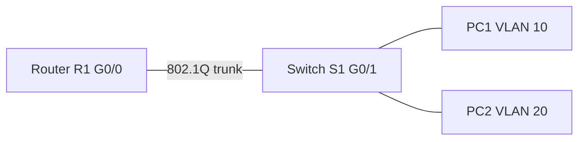

# Enterprise Network Lab — Cisco Packet Tracer

A learning blueprint for router-on-a-stick inter-VLAN routing, two VLANs, DHCP, and basic access-port setup. Build and validate the simulation in Cisco Packet Tracer before describing it as a completed simulation.

## Topology

## Addressing plan

| VLAN | Name | Subnet | Gateway | Example host |
|---|---|---|---|---|
| 10 | STAFF | 192.168.10.0/24 | 192.168.10.1 | 192.168.10.10 |
| 20 | STUDENTS | 192.168.20.0/24 | 192.168.20.1 | 192.168.20.10 |

## Connections
- Router R1 `G0/0` to Switch S1 `G0/1` (trunk)
- PC1 to S1 `F0/2` (VLAN 10)
- PC2 to S1 `F0/3` (VLAN 20)

## Validation
1. Set both PCs to DHCP.
2. Confirm PC1 gets a `192.168.10.x/24` address and gateway `192.168.10.1`.
3. Confirm PC2 gets a `192.168.20.x/24` address and gateway `192.168.20.1`.
4. Ping each PC's gateway; test inter-VLAN connectivity and document results.
5. Router: `show ip interface brief`, `show ip dhcp binding`.
6. Switch: `show vlan brief`, `show interfaces trunk`.

## Compatibility
Interface names vary by Packet Tracer model. Adjust interface IDs to match your devices. This repository currently contains the lab blueprint and CLI configurations, not a `.pkt` file. Save a `.pkt` simulation after you build and test it in Packet Tracer.

Use only simulated devices or networks you are authorized to administer.
